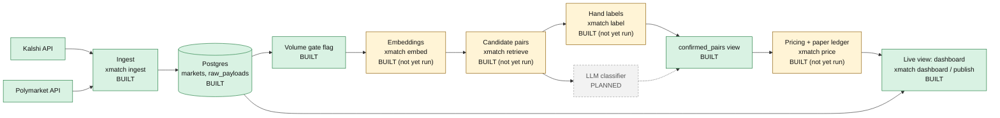
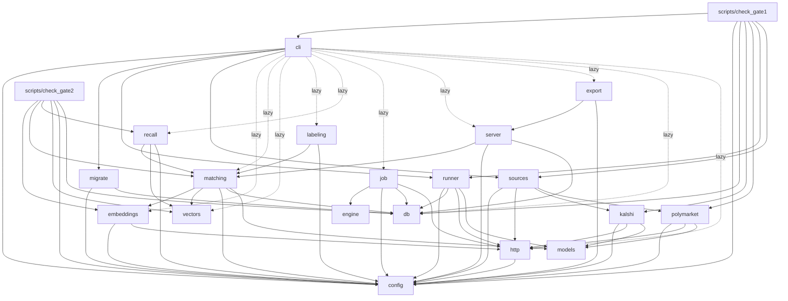
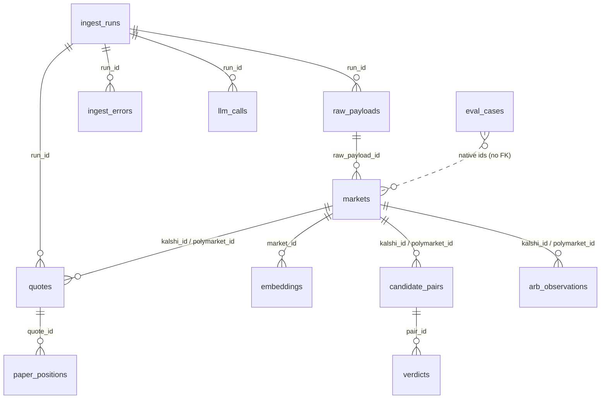

# xmatch architecture

How this repo works, in plain words. Every claim here was checked against the code, the database, or the docs folder on 2026-11-25.

> **Read this first: how the labels work.**
> The request was to mark Milestone 1 as BUILT and Milestones 2 to 4 as PLANNED. The repo is further along than that, so labeling M2 and M4 as planned would be false. Every item carries one of two labels, with a qualifier where it matters:
>
> - **BUILT**: the code exists, has tests, and has run on real data.
> - **BUILT (not yet run)**: the code exists and its tests pass, but it hasn't produced results on real data yet.
> - **PLANNED**: only in the PRD. There is no code.
>
> | Milestone | State |
> |---|---|
> | M1 ingest | **BUILT**. Gate 1 passed 10/10 (`docs/gate1-results.txt`). |
> | M2 embeddings and retrieval | **BUILT (not yet run)**. The code is done. Only 3,552 of 13,633 markets are embedded, and all of them are Kalshi, so there are 0 candidate pairs. |
> | M3 LLM classifier | **PLANNED**. There is no classifier code, `prompts/` is empty, and the `verdicts` table has 0 rows. |
> | M4 pricing and paper trading | **BUILT (not yet run)**. Pulled forward on purpose (D-024). It needs confirmed pairs, and there are 0 labels so far. |

---

## 1. The project in 5 lines

1. **What it does:** it finds pairs of markets on Kalshi and Polymarket that are the same bet, then checks whether buying YES on one and NO on the other costs less than $1.
2. **Why:** if both markets pay out on exactly the same outcome, that price gap is close to risk-free profit. This is a learning project in data and AI engineering, after [Yash Kothari's writeup](https://www.yashkothari.ca/writing/polymarket-kalshi-arbitrage).
3. **In:** public market data from the two platforms' APIs. An *API* is a URL that returns data as JSON.
4. **Out:** rows in a local Postgres database, a dashboard, and later a list of price gaps and a simulated ("paper") trading ledger.
5. **Never:** it never places an order, never holds trading credentials, and has no code that can trade. The platform HTTP client can only send GET requests (`ReadOnlyClient` in `src/xmatch/http.py`).

---

## 2. The big picture

**Terms used below:**
- **Ingest:** pull data in and store it.
- **Embedding:** a list of numbers that captures what a piece of text means. Similar texts get similar lists.
- **Candidate pair:** a Kalshi market and a Polymarket market whose embeddings are close.
- **Classifier:** an LLM that decides whether the two markets really are the same bet.



The same picture in plain text:

```
 Kalshi API ─┐
             ├─> [Ingest] ─> [Postgres: markets + raw_payloads] ─> [Volume gate flag]
 Polymarket ─┘     BUILT            BUILT                               BUILT
                                                                          │
                                                                          v
                         [Embeddings] ─> [Candidate pairs] ─┬─> [Hand labels]     BUILT (not yet run)
                       BUILT (not run)   BUILT (not run)    │          │
                                                            └─> [LLM classifier]  PLANNED
                                                                       │
                                                                       v
                    [confirmed_pairs view] ─> [Pricing + paper ledger] ─> [Dashboard / Vercel snapshot]
                          BUILT                 BUILT (not yet run)              BUILT
```

There are two separately scheduled jobs (PRD DP-10):
- **Slow job:** `xmatch match` runs ingest, then embed, then retrieve. **BUILT.**
- **Fast job:** `xmatch price` runs pricing and the paper ledger. **BUILT (not yet run).**

Nothing schedules them automatically yet. You run them by hand, or with `xmatch price --every 120`.

---

## 3. Request flow, step by step

### 3a. `uv run xmatch ingest` (BUILT)

| # | What happens | File: function |
|---|---|---|
| 1 | `uv run` starts Python in the project's virtual environment and runs the `xmatch` command. `pyproject.toml` maps that command to `xmatch.cli:main`. | `pyproject.toml` |
| 2 | The CLI installs a SIGTERM handler, so a killed job still records its run as failed. Then it parses the arguments. | `src/xmatch/cli.py: main()` |
| 3 | It picks the platforms: `all` means `("kalshi", "polymarket")`, in that order. | `cli.py: cmd_ingest()`, `src/xmatch/sources.py: PLATFORMS` |
| 4 | It loads settings: reads `.env`, reads `config/settings.toml`, and validates both into a `Settings` object. | `src/xmatch/config.py: load_settings()` |
| 5 | For each platform, it builds a GET-only HTTP client and the platform's source object. | `sources.py: open_source()` → `http.py: ReadOnlyClient`, `ingest/kalshi.py: KalshiSource` or `ingest/polymarket.py: PolymarketSource` |
| 6 | It opens two database connections. The *log* connection writes the run row and errors immediately (autocommit). The *data* connection writes each page as one transaction. | `ingest/runner.py: IngestRun.run()` → `db.py: connect()` |
| 7 | It marks old runs stuck as "running" as failed, then inserts one `ingest_runs` row with a snapshot of the config. | `runner.py: IngestRun._start()`, `_fail_abandoned()` |
| 8 | **Kalshi only:** it loads all open events, so market titles get their event context. | `kalshi.py: KalshiSource.prepare()` |
| 9 | It pages through open markets. Kalshi uses `GET /markets?status=open&mve_filter=exclude` with a `cursor` and wraps each market with its event as `{"market", "event"}`. Polymarket uses `GET /markets/keyset?closed=false`, 100 rows per page, with `after_cursor`. | `kalshi.py: KalshiSource.pages()`, `_fill_missing_events()`; `polymarket.py: PolymarketSource.pages()` |
| 10 | Every request goes through rate limiting and retries. Retries happen on 429, 5xx and network errors, waiting longer each time (exponential backoff), plus a little randomness (jitter). | `http.py: _RetryingClient._request_json()`, `_throttle()`, `_backoff()` |
| 11 | For each raw market, it skips duplicates and converts the API's JSON into one standard shape, a `NormalizedMarket`. | `runner.py: IngestRun.run()` → `kalshi.py: normalize()` or `polymarket.py: normalize()` → `models.py: NormalizedMarket` |
| 12 | A market missing its title, rules text or close time is *held out*: stored, but `matchable=false`, with a `holdout_reason`. | `models.py: NormalizedMarket.holdout_reason` |
| 13 | **One transaction per page:** it inserts the raw payloads, computes `content_hash` and the volume-gate flag, and upserts the markets. *Upsert* means insert, or update if the row exists. | `runner.py: IngestRun._write_page()`, `models.py: content_hash()`, `passes_volume_gate()`, SQL `UPSERT_SQL` |
| 14 | After the last page succeeds, it marks markets missing from this run as `listed=false` and prunes old raw payloads. | `runner.py: IngestRun._finalize()` |
| 15 | It sets the run's status to `succeeded`, along with the counts. On any error it rolls back the open page, logs to `ingest_errors`, and marks the run `failed`. | `runner.py: IngestRun._finish()`, `_error()` |
| 16 | It prints one summary line per platform. | `cli.py: cmd_ingest()` |

Result: rows in `ingest_runs`, `raw_payloads` and `markets` (plus `ingest_errors` if something went wrong).

### 3b. `uv run python scripts/check_gate1.py` (BUILT)

| # | Check | How (file: function) |
|---|---|---|
| 1 | Run two fresh live ingests, unless `--reuse-runs` is passed. | `scripts/check_gate1.py: main()` → `cli.py: run_ingest()` twice |
| 2 | Find the two latest successful runs per platform. | `check_gate1.py: latest_runs()` |
| 3 | **Live double run:** no duplicate `(platform, native_id)`, and the count delta is reported. | SQL inside `main()` |
| 4 | **Replay:** feed the latest run's stored raw payloads back through the real normalizer. The table's fingerprint (an MD5 over every column) must not change. | `check_gate1.py: ReplaySource` → `runner.py: IngestRun.run()` → `FINGERPRINT_SQL` |
| 5 | **Count:** within 1% of a second, independent listing (the events endpoints). | `kalshi.py` / `polymarket.py: reference_count()` |
| 6 | **Nulls:** no matchable open market lacks a title, rules text or close time. | SQL inside `main()` |
| 7 | **Forced failure:** run an ingest that crashes on purpose after 3 pages, then check the store is consistent and the run is marked failed. | `IngestRun(..., fail_after_pages=3)` → `runner.py: InjectedFailure` |
| 8 | Print PASS/FAIL lines. The exit code is 0 only if every check passed. | `check_gate1.py: check()`, `main()` |

### 3c. One real pair through the full funnel (mostly BUILT (not yet run); classifier PLANNED)

These are real rows from the database. **This pair is unlabeled.** It's an illustration, not a confirmed match.

| | Kalshi | Polymarket |
|---|---|---|
| id | `KXFEDDECISION-26DEC-C25` | `3215006` |
| title (as stored) | "Fed decision in Dec 2026? — Will the Federal Reserve Cut rates by 25bps at their December 2026 meeting?" | "Will the Fed decrease interest rates by 25 bps after the December 2026 meeting?" |
| volume | $1,524,491 | $10,314,263 |
| close time | 2026-12-09 13:59 ET | 2026-12-09 18:59 ET (**5 hours later**) |
| rules excerpt | "If the Federal Reserve does a Cut of 25bps on December 09, 2026, then the market resolves to Yes … If the scheduled FOMC meeting is canceled … 'Fed maintains rate' resolves to Yes" | "…resolve to the amount of basis points the upper bound of the target federal funds rate is changed by … If the target federal funds rate is changed to a level not expressed in the displayed options…" |

| Stage | What would happen | Code | State |
|---|---|---|---|
| Ingest | Both are stored, both clear the $10K gate, and both are matchable. | `runner.py` | BUILT, done |
| Embed | The title plus short description is turned into a 1,024-number vector by a local model. Neither of these two is embedded yet. | `ai/matching.py: run_embed()`, `ai/embeddings.py: OllamaEmbedder` | BUILT (not yet run) |
| Retrieve | Each Kalshi market's top 10 nearest Polymarket markets, and the reverse, are kept if their similarity is ≥ 0.70. | `ai/vectors.py: mutual_top_k()`, `ai/matching.py: run_retrieve()` | BUILT (not yet run) |
| Label | You read both rules texts side by side and answer confirm or reject. | `ai/labeling.py: label_session()` | BUILT (not yet run) |
| Classify | An LLM reads both rules texts and returns a verdict as JSON. It would have to weigh the 5-hour close-time gap and the two different fallback clauses. | none | **PLANNED** |
| Price | Fetch both order books, find the cheapest asks for YES on one side plus NO on the other, and subtract fees. | `pricing/job.py: run_pricing()`, `pricing/engine.py: price_direction()` | BUILT (not yet run) |
| Paper trade | If the net margin is ≥ 2%, record a simulated position, and settle it from both platforms' official results. | `pricing/job.py: _open_paper()`, `_settle()` | BUILT (not yet run); blocked by the unverified Kalshi fee (D-025) |
| Show | Dashboard panels: funnel, candidate pairs, paper trading. | `dashboard/server.py`, `static/index.html` | BUILT |

---

## 4. Tech stack

### Used now

| Tool | What it is | What it does here | Files |
|---|---|---|---|
| Python 3.12 | The programming language | All the code | `src/`, `scripts/*.py`, `tests/` |
| uv | A fast Python package and environment manager | Installs dependencies, pins exact versions in `uv.lock`, and runs commands (`uv run …`) | `pyproject.toml`, `uv.lock`, `.python-version` |
| pytest | A test runner | 75 unit and integration tests | `tests/`, `[tool.pytest.ini_options]` in `pyproject.toml` |
| httpx | An HTTP client library | Every API call, wrapped with rate limiting and retries | `src/xmatch/http.py` |
| psycopg (v3) | The Python driver for Postgres | Every database read and write | `src/xmatch/db.py` plus every file that runs SQL |
| pydantic | A data-validation library | Turns `settings.toml` into typed objects and fails early on bad config | `src/xmatch/config.py` |
| python-dotenv | Loads a `.env` file into environment variables | Reads `DATABASE_URL` and the API key from `.env` | `src/xmatch/config.py`, `tests/conftest.py` |
| PostgreSQL 15 | A relational database | Stores everything. It runs as a project-local *cluster* (one database server instance), with data in `.pgdata/` on port 5433 | `scripts/db.sh`, `migrations/*.sql` |
| Plain SQL migrations | Numbered `.sql` files that build the schema step by step | Create and alter tables | `migrations/`, `src/xmatch/migrate.py` |
| numpy | A fast array math library | Exact cosine similarity search over embeddings (BUILT (not yet run)) | `src/xmatch/ai/vectors.py`, `ai/recall.py` |
| Embedding wrapper | A small interface (`Embedder`) with one class per provider | Lets you switch the model through config | `src/xmatch/ai/embeddings.py` |
| Ollama + `qwen3-embedding:0.6b` | A local model server, and a small open embedding model | The current embedder (2,752 vectors made so far) | `scripts/ollama.sh`, `[providers.ollama]` and `[embeddings]` in config |
| Gemini API (`gemini-embedding-2`) | Google's hosted embedding model | The previous embedder (800 vectors). Free-tier daily cap; inactive now (D-022) | `ai/embeddings.py: GeminiEmbedder` |
| stdlib `http.server` | Python's built-in web server | The local read-only dashboard on 127.0.0.1:8050 | `src/xmatch/dashboard/server.py` |
| Vercel CLI | Vercel's deploy tool | Publishes a static snapshot of the dashboard (D-021) | `cli.py: cmd_publish()`, `dashboard/export.py` |
| Shell scripts | Bash helpers | `db.sh` starts and stops Postgres; `ollama.sh` starts and stops the local model server | `scripts/db.sh`, `scripts/ollama.sh` |
| pgvector | A Postgres extension for vector search | **Not used.** Homebrew only builds it for Postgres 18 and 19. Replaced by numpy (D-015) | none |

### Planned (PRD only, no code)

| Tool | What it would do | Notes |
|---|---|---|
| LLM classifier (a Gemini model, not chosen) | Decide whether two markets resolve identically, as JSON | PRD section 6, AI-1 to AI-7. Pro-class Gemini models need billing. |
| Versioned prompt files | Store the classifier prompts, with a version number recorded on every verdict | `prompts/` holds only `.gitkeep` |
| Model comparison over 3+ models | Accuracy, cost and latency on the same eval set | PRD section 7 |
| Scheduler | Run the slow and fast jobs automatically | Deferred to Phase 2 |
| pgvector or Pinecone | Faster vector search at larger scale | Would plug in behind `VectorStore` (`ai/vectors.py`) |

---

## 5. File tree

The kinds: **src** = source code, **cfg** = configuration, **gen** = generated, **test**, **docs**, **data** = local data.

```
arbitrage/
├── PRD Cross-Market…md        docs   The product spec. Source of the requirements.
├── README.md                  docs   Quick start and command list.
├── pyproject.toml             cfg    Package name, dependencies, the `xmatch` command, pytest settings.
├── uv.lock                    gen    Exact pinned versions, written by `uv`.            NEVER EDIT BY HAND
├── .python-version            cfg    "3.12", read by uv.
├── .env.example               cfg    Template for .env (names only, no secrets). Committed.
├── .env                       cfg    Real DB URLs and API key. Gitignored.               never commit
├── .gitignore                 cfg    Keeps secrets and data out of git.
├── config/settings.toml       cfg    Every threshold, URL, rate limit and model name.
├── migrations/                       SQL that builds the database, applied in order by `xmatch migrate`.
│   ├── 0001_ingest_runs.sql   src    One row per job run.
│   ├── 0002_ingest_errors.sql src    Per-run error log.
│   ├── 0003_raw_payloads.sql  src    Untouched API JSON.
│   ├── 0004_markets.sql       src    The normalized markets table plus its CHECK rules.
│   ├── 0005_later_milestones.sql src Empty candidate_pairs, verdicts, eval_cases (+ append-only trigger).
│   ├── 0006_markets_raw_payload_index.sql src  Index that made pruning fast.
│   ├── 0007_embeddings_and_llm_calls.sql  src  M2 tables and columns.
│   └── 0008_pricing_and_paper.sql         src  confirmed_pairs view, quotes, arb_observations, paper_positions.
│                                         Applied migrations: NEVER EDIT. Add a new numbered file instead.
├── prompts/.gitkeep           src    Placeholder. Classifier prompts go here (PLANNED).
├── scripts/
│   ├── db.sh                  src    init / start / stop / psql for the local Postgres.
│   ├── ollama.sh              src    start / stop the project-local Ollama on port 11435.
│   ├── check_gate1.py         src    Milestone 1 gate checks.
│   └── check_gate2.py         src    Milestone 2 gate checks (BUILT, never passed: no labels yet).
├── src/xmatch/
│   ├── cli.py                 src    The `xmatch` command: every subcommand.
│   ├── config.py              src    Loads and validates settings.toml and .env.
│   ├── db.py                  src    `connect()` helper.
│   ├── http.py                src    Rate-limited, retrying HTTP clients (GET-only for platforms).
│   ├── migrate.py             src    Applies migrations, recording them in `schema_migrations`.
│   ├── models.py              src    NormalizedMarket, content_hash, volume gate, parsing helpers.
│   ├── sources.py             src    Builds a platform source with its client.
│   ├── ingest/
│   │   ├── kalshi.py          src    Kalshi paging plus normalize.
│   │   ├── polymarket.py      src    Polymarket paging plus normalize.
│   │   └── runner.py          src    Run lifecycle, page transactions, upsert, sweep, prune.
│   ├── ai/
│   │   ├── embeddings.py      src    Embedder interface; Gemini and Ollama implementations.
│   │   ├── vectors.py         src    VectorStore (float4[] in Postgres) plus exact top-K search.
│   │   ├── matching.py        src    The embed job and the retrieve job.
│   │   ├── labeling.py        src    Interactive `xmatch label`.
│   │   └── recall.py          src    Recall versus candidate count, for choosing the similarity floor.
│   ├── pricing/
│   │   ├── engine.py          src    Pure arbitrage math: ladders, fees, sizing.
│   │   └── job.py             src    The pricing pass, arb lifetimes, paper ledger, settlement.
│   └── dashboard/
│       ├── server.py          src    Local read-only JSON API plus the page.
│       ├── export.py          src    Static snapshot for Vercel.
│       └── static/index.html  src    The whole dashboard UI (HTML, CSS and JS in one file).
├── tests/
│   ├── conftest.py            test   Fixtures: a fresh test DB schema per test.
│   ├── unit/                  test   No database: config, http, normalize, engine, vectors.
│   ├── integration/           test   Against the `xmatch_test` DB: runner, matching, labeling, pricing, dashboard, migrate.
│   └── fixtures/*.json        test   Real API responses captured 2026-11-24.            don't edit; recapture instead
├── docs/
│   ├── ARCHITECTURE.md        docs   This file.
│   ├── DECISIONS.md           docs   Decision log, D-001 to D-026.
│   ├── api-notes.md           docs   Verified API facts with URLs and dates.
│   └── gate1-results.txt      gen    Saved output of the Gate 1 run.                    don't edit (it's evidence)
├── .pgdata/  .pglog           data   Postgres files and log. Gitignored.               NEVER EDIT
├── .ollama-models/ .ollama.log data  Downloaded model plus log. Gitignored.             NEVER EDIT
├── site/                      gen    Output of `xmatch export`. Gitignored.             regenerated every publish
└── .venv/                     gen    Virtual environment made by uv. Gitignored.        NEVER EDIT
```

---

## 6. How each kind of file gets made

| File(s) | Made by | When |
|---|---|---|
| `migrations/*.sql` | Hand-written | Once per schema change. Applied by `xmatch migrate` (`migrate.py`), which records each name in `schema_migrations` so it never runs twice |
| `config/settings.toml` | Hand-written | Edited when a threshold or URL changes |
| `.env` | Hand-written by you (copied from `.env.example`) | Once. Holds the DB URLs and the API key |
| `uv.lock` | Generated by `uv sync` / `uv add` | Whenever dependencies change |
| `raw_payloads` rows | Produced at runtime by `runner.py: _write_page()` | Every ingest, one per market. Pruned after 5 runs (D-007) |
| `markets` rows | Produced at runtime by the upsert in `_write_page()` | Every ingest |
| `ingest_runs` / `ingest_errors` rows | Produced at runtime by every job (`runner.py`, `matching.py`, `pricing/job.py`) | Every run |
| `embeddings`, `llm_calls`, `candidate_pairs` rows | Produced at runtime by `matching.py` | `xmatch embed` / `retrieve` |
| `eval_cases` rows | Your answers, written by `labeling.py` | `xmatch label` (append-only) |
| `quotes`, `arb_observations`, `paper_positions` rows | Produced at runtime by `pricing/job.py` | `xmatch price` |
| `docs/*.md` | Hand-written | As decisions are made |
| `docs/gate1-results.txt` | Pasted from the output of `check_gate1.py` | Once, at Gate 1 |
| `tests/fixtures/*.json` | Captured from live API calls, then saved | Once, 2026-11-24 |
| `site/` | Generated by `xmatch export` | Every publish |
| `.pgdata/` | Generated by `initdb` in `scripts/db.sh init` | Once |

---

## 7. What connects to what

This was generated by parsing every Python file's imports with Python's `ast` module, not by reading imports by hand. *Lazy* means the import happens inside a function, only when that command runs.



| File | Imports from (xmatch) | Imported by |
|---|---|---|
| `config.py` | — | 14 modules plus both gate scripts |
| `db.py` | — | runner, migrate, matching, job, server, cli (lazy), check_gate1, check_gate2 |
| `models.py` | — | runner, kalshi, polymarket, matching |
| `http.py` | config | sources, runner, kalshi, polymarket, embeddings, job, cli (lazy) |
| `sources.py` | config, http, kalshi, polymarket | cli, check_gate1 |
| `migrate.py` | config, db | cli |
| `ingest/kalshi.py` | config, http, models | sources, check_gate1 |
| `ingest/polymarket.py` | config, http, models | sources, check_gate1 |
| `ingest/runner.py` | config, db, http, models | cli, check_gate1 |
| `ai/embeddings.py` | config, http | matching, cli (lazy), check_gate2 |
| `ai/vectors.py` | — | matching, recall, cli (lazy), check_gate2 |
| `ai/matching.py` | embeddings, vectors, config, db, models | labeling, recall, server, cli (lazy), check_gate2 |
| `ai/labeling.py` | matching, config | cli (lazy) |
| `ai/recall.py` | matching, vectors, config | cli (lazy), check_gate2 |
| `pricing/engine.py` | — | job |
| `pricing/job.py` | engine, config, db, http | cli (lazy) |
| `dashboard/server.py` | matching, config, db | export, cli (lazy) |
| `dashboard/export.py` | server, config | cli (lazy) |
| `cli.py` | config, migrate, runner, sources (+ lazy: 10 more) | check_gate1 |

**The 3 most important files** are the ones a change would break the most, measured by how many modules depend on each one directly or indirectly:
1. **`config.py`: 16 dependents.** Rename one setting and every job and script that reads it breaks.
2. **`http.py`: 14 dependents.** Every API call goes through it: ingest, embeddings and pricing.
3. **`models.py`: 12 dependents.** It defines `NormalizedMarket` and `content_hash`. Changing the hash recipe re-flags every market for embedding, which is why it carries `hash_version`.

`db.py` (11) is next, but it's a 10-line wrapper.

---

## 8. The database in one page

Database size on 2026-11-25: **6.5 GB**, of which `raw_payloads` is 5.6 GB.

| Table | One row is… | Key columns | Written by | Read by | Rows now |
|---|---|---|---|---|---|
| `markets` | one market on one platform, in standard form | **unique (platform, native_id)**, title, resolution_text, close_time_utc, volume_usd, status, passes_volume_gate, matchable, content_hash, needs_embedding, listed, raw_payload_id | `runner.py` (upsert), `matching.py` (clears needs_embedding) | almost everything | 351,088 |
| `raw_payloads` | the untouched API JSON for one market in one run | run_id, platform, native_id, payload_json | `runner.py` | `runner.py` (prune), `job.py`, `server.py`, `check_gate1.py` | 1,511,994 |
| `ingest_runs` | one run of any job (ingest, embed, retrieve, price) | run_id, job, platform (`all` for non-ingest jobs), status, counts, config_snapshot | runner, matching, job | server, both gate scripts | 25 |
| `ingest_errors` | one logged error | run_id, stage, message, detail | runner, matching, job | server, check_gate1 | 11 |
| `schema_migrations` | one applied migration file | name | `migrate.py` | `migrate.py` | 8 |
| `embeddings` | one market's vector for one model | **PK (market_id, model, dims, text_version)**, content_hash, input_text, vector (`real[]`) | `vectors.py` (via matching) | vectors, matching | 3,552 |
| `llm_calls` | one provider API call | kind, provider, model, items, tokens_in, latency_ms, cost_usd, status | `matching.py` | server, check_gate2 | 54 |
| `candidate_pairs` | one Kalshi/Polymarket pair that passed retrieval | kalshi_id, polymarket_id, similarity, retrieval_version, rank_k2p, rank_p2k | `matching.py` | server, labeling, matching, check_gate2 | 0 |
| `eval_cases` | one hand label (append-only; a DB trigger blocks updates) | kalshi_native_id, polymarket_native_id, label, reason, deciding_clause, failure_mode, split | `labeling.py` | recall, labeling, server, check_gate2, the `confirmed_pairs` view | 0 |
| `verdicts` | one LLM verdict (PLANNED) | unique (pair_hash, prompt_version, model_id) | nothing yet | server, matching (to keep pairs that verdicts point to) | 0 |
| `confirmed_pairs` (a view, not a table) | a pair whose latest label is `must_confirm` | kalshi_id, polymarket_id, source | (computed) | `job.py` | 0 |
| `quotes` | one pair × direction × pricing pass | k_ask, p_ask, contracts, cost_usd, net_margin, status, fee_version | `job.py` | server | 0 |
| `arb_observations` | one arb window, from first seen to last seen | first_seen, last_seen, best_net_margin, open | `job.py` | server | 0 |
| `paper_positions` | one simulated hedge | contracts, cost_usd, expected_net_margin, status, payout_usd, pnl_usd | `job.py` | job, server | 0 |



`eval_cases` links to markets by native id text, not by a foreign key, so labels survive a rebuild of the database.

---

## 9. Where the config and secrets live

**Rule:** numbers and URLs go in `config/settings.toml`; secrets go only in `.env`. `config.py: load_settings()` reads both. A missing or misspelled TOML key fails immediately with a pydantic validation error, before any job starts.

| Setting | Defined in | Read by | If missing |
|---|---|---|---|
| `DATABASE_URL` | `.env` | `config.py` → everything | `RuntimeError: DATABASE_URL is not set` |
| `TEST_DATABASE_URL` | `.env` | `tests/conftest.py` | Integration tests are skipped |
| `XMATCH_GEMINI_API_KEY` | `.env` (name set by `providers.gemini.api_key_env`) | `config.py: Settings.api_key()` → `GeminiEmbedder` | Error, but only when the Gemini provider is used |
| `OPENAI_API_KEY`, `ANTHROPIC_API_KEY` | `.env` (placeholders) | **nothing reads them** | nothing |
| `XMATCH_CONFIG` (optional) | environment | `config.py` | Falls back to `config/settings.toml` |
| `[http]` timeout and retries | toml | `http.py` via `sources.py`, `embeddings.py`, `cli.py` | Validation error |
| `[kalshi]`, `[polymarket]` URLs, page sizes, rate limits | toml | `ingest/kalshi.py`, `ingest/polymarket.py`, `sources.py`, `cli.py: cmd_price` | Validation error |
| `[volume_gate] min_volume_usd` = 10000 | toml | `ingest/runner.py` (sets the flag), `dashboard/server.py` (display) | Validation error |
| `[ingest]` keep_runs, hash_version, stale_run_minutes | toml | `ingest/runner.py` | Validation error |
| `[gate1]`, `[gate2]` targets | toml | `check_gate1.py`; `check_gate2.py`, `cli.py: cmd_recall` | Validation error |
| `[providers.*]`, `[embeddings]` | toml | `ai/embeddings.py`, `ai/matching.py`, `dashboard/server.py` | Validation error |
| `[retrieval]` top_k, similarity_floor | toml | `ai/matching.py`, `ai/recall.py`, `cli.py`, `server.py`, `check_gate2.py` | Validation error |
| `[eval]` holdout settings | toml | `cli.py: cmd_label` | Validation error |
| `[pricing]` freshness, min margin, URLs | toml | `pricing/job.py`, `cli.py: cmd_price`, `server.py` | Validation error |
| `[fees] kalshi_coefficient` | toml, **deliberately commented out** | `pricing/job.py`, `server.py` | Defaults to unset: Kalshi legs priced gross, **no paper trades** (D-025) |
| `[paper]` bankroll and per-trade cap | toml | `pricing/job.py`, `server.py` | Validation error |

Secret values are never printed here. `.env` has never been committed (checked against the full git history).

---

## 10. Gaps and surprises

**Differs from the PRD**

| Item | PRD | Repo | Why |
|---|---|---|---|
| Milestone order | M3 classifier and Gate 3 before any pricing | M4 pricing and paper ledger built first; M3 not built | D-024: paper trading on hand-confirmed pairs only |
| Embedding model | OpenAI `text-embedding-3-large` | Local `qwen3-embedding:0.6b` (Gemini before that) | D-016, D-022, D-023 |
| Vector store | pgvector or Pinecone | `real[]` columns plus numpy exact search | D-015: pgvector won't build for Postgres 15 |
| Prices | Integer cents | `numeric` dollars | Kalshi quotes below a cent |
| Deployment | No cloud in Phase 1 | Vercel static snapshot, public URL | D-021, at the user's request |
| Docker | docker compose | Local Postgres via `scripts/db.sh` | D-002 |

**Half-built**
- **Embeddings:** 3,552 vectors exist, all for **Kalshi** markets: 2,752 from Qwen and 800 from Gemini. Retrieval therefore finds **0 pairs**, and Gate 2 can't pass yet.
- **Labels:** 0 in `eval_cases`, so `confirmed_pairs` is empty and pricing has nothing to price.
- **Kalshi fee coefficient:** unverified, because the fee PDF is bot-blocked. Paper trades can't open until a person sets it.
- **`prompts/`:** empty. The `verdicts` table is never written. The PRD's AI-1 to AI-7 requirements are mostly unmet; only AI-4-style cost logging exists, for embeddings.
- **Gate 2's similarity floor (0.70):** a placeholder, not chosen from data yet.

**Raw-data oddities**
- **Market counts are about 4× the reference.** Kalshi has 178k open markets, excluding combos, against ~44.4k. Polymarket has 150.8k against ~45k. Most of Kalshi's are long-tail strike ladders. Only ~8.0k Kalshi and ~5.6k Polymarket markets clear the $10K gate.
- **Polymarket's events listing nests ~26.7k inactive placeholder outcomes** (for example "Person AC"), which its markets listing never returns (D-014).
- **About 32k Polymarket markets with `closed=false` are past their end date,** awaiting resolution. They're kept on purpose (D-013).
- **Kalshi volume is counted in contracts, not dollars.** It's converted as contracts × notional (D-004).
- **Kalshi market titles often lack context,** for example "Prairie View A&M wins". The event title is prepended (D-008).
- **The example pair's close times differ by 5 hours** (13:59 vs 18:59 ET). This is the "same date, different moment" trap the classifier must catch.

**Code quirks found while writing this**
- **`ingest_runs` holds every job type** (embed, retrieve, price), not just ingest. The name is a misnomer.
- **`rows_read` on a run row is written only when the run ends,** so a running job shows 0.
- **`check_gate1.py: latest_runs()` counts its own replay runs as "successful ingest runs".** Running it with `--reuse-runs` right after a replay compares the replay against a live run, not two live runs.
- **`config.py: settings()`** (a cached loader) is never called; everything uses `load_settings()`.
- **`raw_payloads` is 5.6 GB** even though only 5 runs are kept, because every run stores about 330k payloads. Disk space is the practical limit.

---

## 11. Self-test

1. Which file would you edit to change the volume gate, and what code reads that value?
2. Why are there two database connections inside one ingest run?
3. What does `content_hash` cover, and what is it deliberately *not* computed from?
4. If an ingest crashes on page 4, what state are pages 1–3 and page 4 in?
5. Why can't the pricing job open any paper trade right now, even with confirmed pairs?
6. How does the code make sure it can never send an order to Kalshi or Polymarket?
7. Where do embeddings live, and what would you write to move them to pgvector?
8. How does a pair become eligible for pricing today, and how will that change in M3?
9. Retrieval currently finds 0 pairs. Why, specifically?
10. Which three files would break the most code if you changed their interface?

<details>
<summary>Answers</summary>

1. `config/settings.toml`, `[volume_gate] min_volume_usd`. `ingest/runner.py: _write_page()` uses it to set `passes_volume_gate`, and `dashboard/server.py` displays it. Later stages read the stored column, not the config value.
2. The *log* connection (autocommit) writes the run row and errors immediately, so they survive a crash. The *data* connection commits one transaction per page, so a crash rolls back only the page in flight.
3. Whitespace-normalized title plus resolution text, plus `hash_version`. It deliberately excludes prices and volume, so price moves don't trigger re-embedding.
4. Pages 1–3 are committed and valid. Page 4 is rolled back completely, raw payloads included. The run row says `failed`, an `ingest_errors` row has the traceback, and no market is marked unlisted, because the sweep only runs on success.
5. `[fees] kalshi_coefficient` is unset (D-025), so every Kalshi leg is marked `fee_unverified` and `_open_paper()` is never called.
6. Platform calls go through `ReadOnlyClient`, which only has `get_json()`. Even Polymarket's batch book endpoint is avoided because it's a POST (D-026). `ProviderClient` (which can POST) only ever points at AI providers.
7. In the `embeddings` table, as `real[]`, searched in numpy by `PgArrayStore` and `mutual_top_k()` in `ai/vectors.py`. You'd write another class implementing the `VectorStore` protocol (`upsert` and `load`), plus a migration.
8. Its latest `eval_cases` label must be `must_confirm` (the `confirmed_pairs` view in migration 0008), and the Polymarket outcomes must be exactly Yes/No. In M3, classifier verdicts (`equivalent` plus `direction_safe` plus evidence) would be UNIONed into that view.
9. All 3,552 stored vectors are for Kalshi markets. The embed job goes in market-id order and was stopped before reaching any Polymarket market, so there's nothing to compare against.
10. `config.py` (16 dependents), `http.py` (14), `models.py` (12).

</details>
